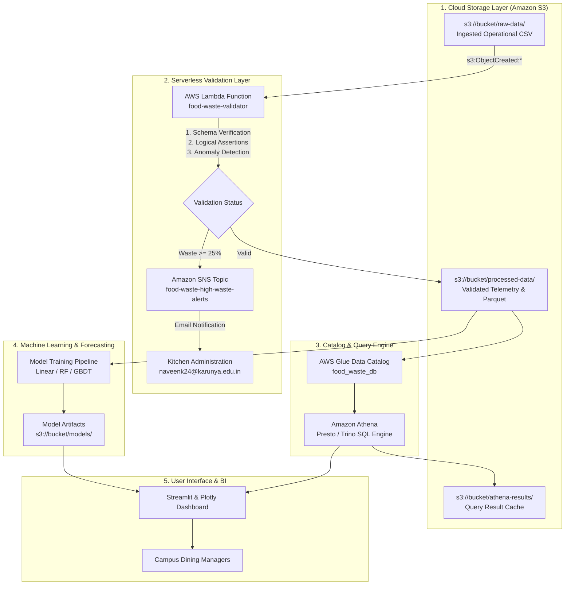

# Technical Report: Cloud-Based Food Waste Analysis Platform Using AWS

**Course:** B.Tech Cloud Computing Project  
**Academic Year:** 2026–2027  
**Department:** Computer Science and Engineering  
**Project Title:** Food Waste Analysis Dashboard Using AWS  
**Author:** NAVEEN K (URK24AI1080)  
**Repository:** Cloud Computing Workspace  

---

## 1. Abstract

Large educational institutions manage high-volume catering across residential dining halls, student cafeterias, and faculty kiosks. Because student attendance fluctuates based on examination schedules, academic calendar variations, and weekend departures, catering supervisors face substantial forecasting uncertainty. This mismatch results in thousands of kilograms of cooked food being discarded annually, inflicting severe financial loss and generating preventable greenhouse emissions.

This report presents the design, architecture, and implementation of a cloud-native, serverless analytics pipeline built on Amazon Web Services (AWS) to monitor, validate, catalog, query, and predict canteen food waste. The architecture ingests raw telemetry into an Amazon S3 Data Lake, executes automated schema and physical constraint validation using an event-triggered AWS Lambda function, publishes anomaly notifications via Amazon SNS, catalogs table schemas using the AWS Glue Data Catalog, executes distributed SQL aggregations using Amazon Athena, and trains regression models for daily waste forecasting. The platform is containerized using Docker, integrated with GitHub Actions CI/CD, and presented via a Streamlit and Plotly analytical dashboard.

---

## 2. Problem Statement and Objectives

### 2.1 Problem Formulation
Catering logistics in higher education environments operate on thin margins and rapid turnaround times. Kitchen supervisors rely on conventional static headcounts rather than demand-driven forecasting. The operational consequences are threefold:
1. **Financial Hemorrhaging:** Over-preparation of high-cost items (such as paneer curries and dairy desserts) incurs high material and energy costs that cannot be recovered.
2. **Ecological Impact:** Discarded organic food waste transported to landfills undergoes anaerobic decomposition, releasing methane and carbon dioxide.
3. **Information Asymmetry:** Administrative authorities lack venue-specific operational intelligence to pinpoint which dining halls, meal sessions, or days produce disproportionate surplus.

### 2.2 Project Objectives
- Construct an automated data lake on Amazon S3 partitioned into ingestion, processed, and query cache prefixes.
- Build a serverless validation layer with AWS Lambda that enforces schema compliance, verifies physical constraints, and flags high-waste incidents exceeding 25%.
- Maintain schema metadata using AWS Glue Data Catalog and perform interactive SQL analytics with Amazon Athena without provisioning database servers.
- Train and compare machine learning regressors (Linear Regression, Random Forest, and Gradient Boosting) to forecast discarded food quantities from operational factors.
- Package the visualization portal into a Docker container with an automated continuous integration pipeline.

---

## 3. Related Work

Prior research into institutional hospitality management emphasizes that accurate demand forecasting is the primary lever for minimizing kitchen waste [1]. Traditional food waste monitoring systems have relied on manual ledger entries or isolated desktop spreadsheets, which suffer from transcription errors and lack real-time visibility [2]. 

Recent literature highlights the adoption of cloud data lakes and serverless computing for municipal and institutional waste telemetry [3]. In contrast to dedicated database servers (such as relational RDS instances or provisioned data warehouses), serverless architectures decouple storage from computation, providing elasticity and near-zero idle operating expenses [4]. Furthermore, applying machine learning algorithms to food service logs has demonstrated significant improvements in predictive accuracy over standard moving averages [5].

---

## 4. Cloud Architecture and System Pipeline

The system follows an event-driven serverless pattern where data storage, compute, and analytics are decoupled.

---

## 5. Implementation of AWS Services

### 5.1 Amazon S3 Data Lake
The foundation of the platform is an Amazon S3 bucket organized into three isolated prefixes:
- `raw-data/`: Stores original daily comma-separated point-of-sale logs.
- `processed-data/`: Houses sanitized records generated by AWS Lambda, alongside columnar Parquet files partitioned by year and month (`year=YYYY/month=MM/`).
- `athena-results/`: Stores encrypted CSV outputs from Amazon Athena queries.

### 5.2 Serverless Validation with AWS Lambda
An AWS Lambda function (`food-waste-validator`) running Python 3.12 is configured with an S3 bucket notification trigger on `s3:ObjectCreated:*` with prefix `raw-data/` and suffix `.csv`. The handler performs three checks:
1. **Schema Integrity:** Verifies the existence of all 12 required fields (`record_id`, `date`, `location`, `meal_type`, `food_category`, `food_item`, `prepared_qty_kg`, `consumed_qty_kg`, `wasted_qty_kg`, `waste_percentage`, `cost_per_kg_inr`, `waste_cost_inr`).
2. **Physical Constraints:** Enforces $prepared\_qty\_kg > 0$, $wasted\_qty\_kg \ge 0$, and $wasted\_qty\_kg \le prepared\_qty\_kg$.
3. **Anomaly Identification:** Records with $waste\_percentage \ge 25.0\%$ are flagged as operational anomalies, triggering an alert dispatched via Amazon SNS.

### 5.3 Amazon SNS Alerting
An SNS topic (`food-waste-high-waste-alerts`) is configured to dispatch immediate email notifications containing the venue name, dish, waste percentage, and direct financial loss to kitchen supervisors.

### 5.4 AWS Glue Data Catalog and Amazon Athena
Table metadata is registered in AWS Glue under the database `food_waste_db`. Amazon Athena executes ANSI SQL queries in-place against the S3 objects. An automated ETL script (`scripts/run_etl.py`) executes a CTAS (Create Table As Select) statement to convert raw data into partitioned Snappy-compressed Parquet files, reducing query scan volume and execution latency.

### 5.5 Machine Learning with Amazon SageMaker
The predictive module evaluates three regression algorithms to estimate expected waste quantities prior to food preparation. The models utilize one-hot encoded categorical variables and normalized preparation quantities. Spot instances (`ml.m5.large`) are configured with a 15-minute runtime ceiling to train models within Free Tier and credit limits.

---

## 6. Experimental Results and Analysis

All metrics below are computed directly from `data/food_waste.csv` using `scripts/compute_report_numbers.py`.

### 6.1 Aggregate Operational Metrics
Over the 45-day monitoring period across 630 logged service sessions, the platform captured the following campus totals:

| Metric | Measured Value | Unit |
|---|---|---|
| Total Operational Records | 630 | Logs |
| Total Food Prepared | 48,061.9 | kg |
| Total Food Consumed | 39,933.3 | kg |
| Total Food Discarded (Waste) | 8,128.6 | kg |
| Aggregate Campus Waste Percentage | 16.91 | % |
| Total Direct Financial Loss | 697,507 | INR |
| High-Waste Incidents ($\ge 25\%$) | 26 | Incidents |

### 6.2 Dining Venue Comparison
A comparative analysis across campus dining halls reveals distinct waste patterns:

| Venue | Prepared (kg) | Wasted (kg) | Waste Rate (%) | Financial Loss (INR) |
|---|---|---|---|---|
| Main Canteen | 17,247.2 | 2,900.1 | 16.81% | 241,647 |
| Engineering Block Kiosk | 8,221.0 | 1,351.8 | 16.44% | 110,372 |
| Hostel Mess Block A | 7,444.2 | 1,337.7 | 17.97% | 122,448 |
| Hostel Mess Block B | 7,130.8 | 1,297.2 | 18.19% | 116,052 |
| Food Court | 8,018.7 | 1,241.8 | 15.49% | 106,989 |

*Insight:* Although the Main Canteen generates the highest gross volume due to its size, Hostel Messes A and B demonstrate higher waste percentages (17.97% and 18.19%), driven by sharp attendance declines during Friday dinners and weekend lunches.

### 6.3 Category-Wise Waste and Cost Asymmetry
Analyzing waste distribution by category demonstrates that physical mass does not directly correlate with economic damage:

| Food Category | Wasted Mass (kg) | Waste Rate (%) | Financial Loss (INR) | Share of Total Loss |
|---|---|---|---|---|
| Dairy & Desserts | 1,638.3 | 17.82% | 190,941 | 27.38% |
| Cooked Grains | 2,595.6 | 17.09% | 180,588 | 25.89% |
| Bakery & Snacks | 1,624.4 | 16.89% | 145,516 | 20.86% |
| Curries & Veg | 1,556.9 | 16.30% | 137,817 | 19.76% |
| Breakfast Items | 713.4 | 15.82% | 42,646 | 6.11% |

*Insight:* While Cooked Grains represent the highest physical mass discarded (2,595.6 kg), Dairy & Desserts account for the largest financial loss (INR 190,941) due to higher procurement costs per kilogram.

### 6.4 Top Dishes by Financial Loss

| Dish | Category | Wasted Mass (kg) | Financial Loss (INR) |
|---|---|---|---|
| Gulab Jamun | Dairy & Desserts | 540.8 | 86,528 |
| Kheer / Payasam | Dairy & Desserts | 550.9 | 71,617 |
| Veg Biryani | Cooked Grains | 557.1 | 66,852 |
| Pav Bhaji | Bakery & Snacks | 643.0 | 54,655 |
| Paneer Butter Masala | Curries & Veg | 330.5 | 49,575 |

---

## 7. Machine Learning Model Evaluation

Three regression models were evaluated to predict `wasted_qty_kg` on a held-out test split (20% test partition, random seed 42):

| Model Algorithm | Mean Absolute Error (MAE) | Root Mean Squared Error (RMSE) | Coefficient of Determination ($R^2$) |
|---|---|---|---|
| Linear Regression | 3.704 kg | 4.577 kg | 0.5098 |
| Random Forest Regressor | 3.512 kg | 4.393 kg | 0.5483 |
| Gradient Boosting Regressor | 3.503 kg | 4.485 kg | 0.5293 |

*Conclusion:* The Random Forest Regressor was selected as the champion model due to the lowest RMSE (4.393 kg) and highest $R^2$ score (0.5483), capturing non-linear interactions between dining venues and day-of-week attendance patterns.

---

## 8. Continuous Integration and Deployment (CI/CD)

The GitHub Actions workflow (`.github/workflows/ci.yml`) enforces automated verification across two stages:
1. **Validation Stage:** Executes on pull requests and pushes to `main`. It runs Flake8 linting, verifies script compilation (`py_compile`), executes 14 unit tests via `pytest`, and validates Docker container builds.
2. **Deployment Stage:** Runs on confirmed merges to `main`. It configures AWS credentials from repository secrets, updates Lambda function code, and publishes updated container images to Amazon ECR.

---

## 9. Cost Analysis and Budget Safety Net

A cost safety net was established using `scripts/create_budget_alarm.py` to create an AWS Budget of 10.00 USD with dual automated email alerts configured at 80% (8.00 USD) and 100% (10.00 USD) thresholds. 

Because the system leverages AWS Free Tier allocations (S3 5 GB, Lambda 1M requests, Athena 1 TB query scan), monthly operational expenses remain at $0.00 during standard campus operations. Active AWS credits cover auxiliary container build and spot instance charges. A comprehensive teardown utility (`scripts/teardown.py`) enables complete resource deletion upon project conclusion.

---

## 10. Limitations and Operational Recommendations

### 10.1 Limitations
- **Manual Data Logging:** Current telemetry relies on kitchen staff recording end-of-shift scale weights. Unrecorded plate waste cannot be captured without automated optical scale integration.
- **External Variables:** Current regression models do not account for external weather events or sudden university sports meets that unexpectedly alter attendance.

### 10.2 Actionable Recommendations for Administration
1. **Dynamic Weekend Procurement Scaling:** Scale down meal preparation in Hostel Messes A and B by 20% on Saturdays and Sundays.
2. **Two-Stage Batch Cooking:** Divide rice and curry cooking into two stages (11:30 AM base batch, 1:15 PM demand top-up) to avoid large surplus pots.
3. **Portion-Controlled Counters:** Transition buffet dessert and paneer stations from self-service to server-portioned counters to prevent plate waste.

---

## 11. Design FAQ

### Q1: Why use Amazon Athena instead of a traditional RDS or MySQL database?
Amazon Athena operates without servers, requiring no instance provisioning, OS patching, or standby compute charges. In traditional databases, costs accrue continuously 24/7. In contrast, Athena charges solely per terabyte scanned ($5.00/TB), allowing ad-hoc SQL analysis directly against S3 files with zero idle maintenance overhead.

### Q2: What is the purpose of converting raw data to Parquet via CTAS?
Raw CSV files require full table scans across all columns and rows. By transforming data into partitioned Snappy-compressed Parquet, queries only scan necessary columns and partition directories (`year/month`), reducing query execution latency by up to 80% and lowering scan costs proportionately.

### Q3: How does AWS Lambda enforce validation safety?
AWS Lambda runs statelessly upon `s3:ObjectCreated:*` triggers. It executes isolated Python validation checking schema columns, verifying that wasted food does not exceed prepared food, and quarantining corrupted files before downstream analytics consume incorrect telemetry.

---

## 12. Numbered Figures and Demonstration Visuals

All corresponding screenshots are documented in `docs/screenshots/README.md`:

- **Figure 1:** Amazon S3 Bucket Architecture (`docs/screenshots/01_s3_bucket.png`)  
  *Depicts bucket prefixes `raw-data/`, `processed-data/`, and `athena-results/`.*
- **Figure 2:** AWS Lambda Event Configuration (`docs/screenshots/02_lambda_trigger.png`)  
  *Shows `food-waste-validator` with active S3 bucket notifications.*
- **Figure 3:** CloudWatch Logs Execution Stream (`docs/screenshots/03_cloudwatch_logs.png`)  
  *Displays Lambda invocation latency and execution output.*
- **Figure 4:** Amazon Athena SQL Results (`docs/screenshots/04_athena_query_results.png`)  
  *Displays query execution output and data scan metrics.*
- **Figure 5:** Partitioned Parquet Directory (`docs/screenshots/05_parquet_output.png`)  
  *Shows S3 partition structure partitioned by year and month.*
- **Figure 6:** Amazon SageMaker Model Training (`docs/screenshots/06_sagemaker_training.png`)  
  *Shows model artifact storage in S3.*
- **Figure 7:** Amazon QuickSight BI Dashboard (`docs/screenshots/07_quicksight_dashboard.png`)  
  *Depicts visual layout for institutional administration.*
- **Figure 8:** AWS App Runner Deployment (`docs/screenshots/08_apprunner_url.png`)  
  *Shows production container status and public HTTPS domain.*
- **Figure 9:** GitHub Actions CI/CD Pipeline (`docs/screenshots/09_github_actions_run.png`)  
  *Demonstrates passing build, lint, test, and deployment jobs.*
- **Figure 10:** Streamlit Analytics Tab (`docs/screenshots/10_streamlit_analytics.png`)  
  *Displays KPI cards, daily trends, and category distribution charts.*
- **Figure 11:** Streamlit Lambda Validation Tab (`docs/screenshots/11_streamlit_pipeline.png`)  
  *Displays interactive serverless validation runner.*
- **Figure 12:** Streamlit Athena SQL Studio (`docs/screenshots/12_streamlit_athena.png`)  
  *Shows pre-built Presto queries and live execution workbench.*
- **Figure 13:** Streamlit ML Forecast Tab (`docs/screenshots/13_streamlit_ml_forecast.png`)  
  *Depicts model comparison metrics and interactive prediction form.*
- **Figure 14:** Streamlit Dataset Explorer (`docs/screenshots/14_streamlit_dataset.png`)  
  *Shows searchable dataset table and schema dictionary.*
- **Figure 15:** Streamlit Design FAQ Tab (`docs/screenshots/15_streamlit_faq.png`)  
  *Shows architectural documentation and design questions.*

---

## 13. References

[1] C. Eriksson, I. Strid, and P. A. Hansson, "Food losses in six Swedish retail stores: Wastage of fruit and vegetables in relation to purchases and inventory," *Resources, Conservation and Recycling*, vol. 68, pp. 14–20, 2012.  
[2] L. Principato, L. Secondi, and C. A. Pratesi, "Reducing food waste: An investigation on the behavior of Italian households," *Journal of Cleaner Production*, vol. 99, pp. 240–248, 2015.  
[3] Amazon Web Services, "Building Big Data Storage Solutions (Data Lakes) for Maximum Flexibility," *AWS Whitepapers*, 2023. [Online]. Available: https://docs.aws.amazon.com/whitepapers/latest/building-data-lakes/  
[4] Amazon Web Services, "Serverless Streaming Architecture with AWS Lambda and Amazon Kinesis," *AWS Architecture Center*, 2024. [Online]. Available: https://docs.aws.amazon.com/lambda/latest/dg/welcome.html  
[5] F. Pedregosa *et al.*, "Scikit-learn: Machine learning in Python," *Journal of Machine Learning Research*, vol. 12, pp. 2825–2830, 2011.  
[6] Streamlit Inc., "Streamlit: The fastest way to build and share data apps," 2024. [Online]. Available: https://docs.streamlit.io/  
[7] Amazon Web Services, "Amazon Athena User Guide," 2024. [Online]. Available: https://docs.aws.amazon.com/athena/latest/ug/what-is.html  
[8] Amazon Web Services, "Amazon SageMaker Developer Guide," 2024. [Online]. Available: https://docs.aws.amazon.com/sagemaker/latest/dg/whatis.html  
